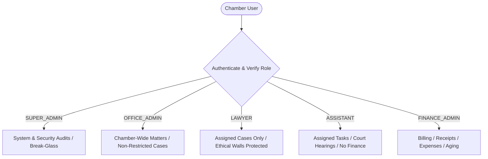
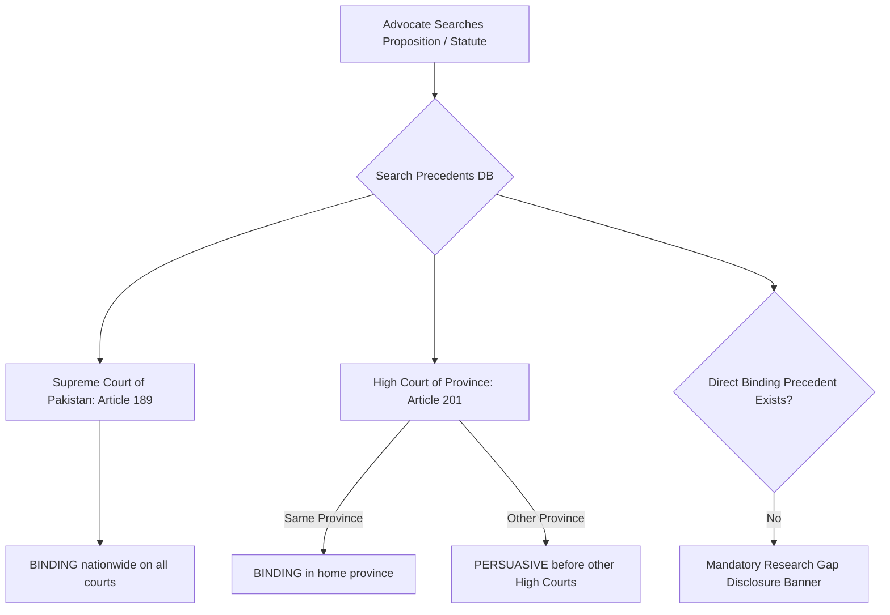

# Lawyer Management System (LMS)
## Chamber Administration & User Guide

**Target Audience:** Managing Partners, Advocates, Court Clerks, Finance Officers & System Administrators  
**Jurisdiction:** Islamic Republic of Pakistan (Supreme Court & Provincial High Courts)  
**System URL:** `http://localhost:3000` (Local Development) | `https://lms.chambers.pk` (Production)  
**Reference Specification:** [docs/MASTER_SPEC.md](file:///c:/Users/HP/Documents/Law%20Firm%20managemnet/docs/MASTER_SPEC.md)

---

## Table of Contents
1. [Quick Start & Demo Personas](#1-quick-start--demo-personas)
2. [Chamber Staff Roles & Access Matrix](#2-chamber-staff-roles--access-matrix)
3. [Case Dossier & Practice Workflow](#3-case-dossier--practice-workflow)
4. [Court Hearings, Diary & Docket Tasks](#4-court-hearings-diary--docket-tasks)
5. [Document Management, Versioning & Malware Defense](#5-document-management-versioning--malware-defense)
6. [Billing, Receipts & Financial Compliance](#6-billing-receipts--financial-compliance)
7. [AI Document Assistant & Multilingual OCR](#7-ai-document-assistant--multilingual-ocr)
8. [Legal Research & Constitutional Precedent Hierarchy](#8-legal-research--constitutional-precedent-hierarchy)
9. [Drafting Library & Approval Safeguards](#9-drafting-library--approval-safeguards)
10. [Client Communications & Dual-Channel Sharing](#10-client-communications--dual-channel-sharing)
11. [Disaster Recovery & Administration Protocol](#11-disaster-recovery--administration-protocol)

---

## 1. Quick Start & Demo Personas

The system features pre-configured chamber personas accessible on the login screen (`/login`):

| Persona Name | Role | Email | Password | Primary Scope |
|---|---|---|---|---|
| **Advocate Salman Akram** | `LAWYER` | `counsel.alpha@lawfirm.local` | `LocalDevPassword123!` | Lead Counsel for general matter `WP-101/2026` |
| **Advocate Asma Jahangir** | `LAWYER` | `counsel.beta@lawfirm.local` | `LocalDevPassword123!` | Counsel for confidential ethical wall matter `CS-202/2026` |
| **Barrister Aitzaz Khan** | `OFFICE_ADMIN` | `senior.partner@lawfirm.local` | `LocalDevPassword123!` | Managing Partner (Firm-wide oversight, case assignments) |
| **Muhammad Usman** | `ASSISTANT` | `clerk.one@lawfirm.local` | `LocalDevPassword123!` | Senior Court Clerk (Hearings diary, cause lists, tasks) |
| **Bilal Siddiqui** | `FINANCE_ADMIN` | `finance.head@lawfirm.local` | `LocalDevPassword123!` | Finance Manager (Billing, installments, expenses, receipts) |
| **Tariq Mahmood** | `SUPER_ADMIN` | `admin.dev@lawfirm.local` | `LocalDevPassword123!` | System Administrator (Audit logs, break-glass protocol) |

> [!TIP]
> **One-Click Login:** On the login page (`/login`), click any button under **"Chambers Staff Personas (Demo)"** to instantly populate credentials.

---

## 2. Chamber Staff Roles & Access Matrix

Access permissions are enforced strictly at the database engine level via **PostgreSQL Row-Level Security (RLS)**:



### Key Security Safeguards:
- **Ethical Walls (`isRestricted = true`)**: Cases involving conflicts of interest or sensitive corporate/political matters are sealed. Unassigned advocates and Office Admins cannot find or query restricted cases through search, dashboards, or AI.
- **Break-Glass Emergency Protocol**: If a lead counsel is incapacitated, a Super Admin can request emergency time-bound access, which requires written justification and triggers immutable audit alerts.
- **Append-Only Audit Trail**: Every login, status transition, document view, and payment is permanently logged in `audit_events`.

---

## 3. Case Dossier & Practice Workflow

### 3.1 Creating a New Case
1. Navigate to **Cases** in the sidebar $\rightarrow$ Click **New Matter** (`/cases/new`).
2. Complete mandatory details:
   - **Case Number:** Formatted per court conventions (e.g. `WP-101/2026`, `Crl.A-45/2026`).
   - **Case Title:** e.g. *Messrs Apex Traders v. Federation of Pakistan*.
   - **Court & Bench:** Select court (`Supreme Court`, `Lahore High Court`, etc.) and bench seat.
   - **Client:** Link an existing client or institutional corporate entity.
   - **Restricted Ethical Wall Toggle:** Enable to restrict visibility to explicitly assigned lawyers.

### 3.2 Matter Status Lifecycle (Bilingual English / Urdu)
Matters advance through 8 standardized states:
1. `DRAFT` (ابتدائی مسودہ) $\rightarrow$ Initial intake and pleadings preparation.
2. `ACTIVE` (زیرِ سماعت) $\rightarrow$ Formal institution before the court.
3. `AWAITING_HEARING` (منتظر سماعت) $\rightarrow$ Fixed on upcoming cause list.
4. `AWAITING_CLIENT` (منتظر موکل) $\rightarrow$ Requiring client instructions or documentation.
5. `JUDGMENT_RESERVED` (فیصلہ محفوظ) $\rightarrow$ Final arguments concluded.
6. `DECIDED` (فیصلہ شدہ) $\rightarrow$ Final decree or order passed.
7. `APPEALED` (اپیل دائر) $\rightarrow$ Subject to intra-court or apex appeal.
8. `CLOSED` (بند شدہ) $\rightarrow$ Archival completion.

> [!NOTE]
> To update a status, open the case dossier and click the **"Transition Status"** button in the header card.

---

## 4. Court Hearings, Diary & Docket Tasks

### 4.1 Daily Hearing Diary & Cause Lists
- Open the **Hearings** tab inside any case dossier.
- Click **"Schedule Hearing"** to record upcoming dates, courtroom numbers, and presiding judges.
- Categorize hearing stages: *Preliminary Objections, Arguments, Framing of Issues, Interim Injunction, Judgment*.

### 4.2 Docket Action Items & Tasks
- Open the **Tasks** tab to create actionable litigation items (e.g. *Draft Rejoinder to Written Statement*).
- Assign priority levels: `LOW`, `MEDIUM`, `HIGH`, `URGENT`.
- Tasks link to case assignment permissions, keeping clerk task lists synchronized with counsel calendars.

---

## 5. Document Management, Versioning & Malware Defense

### 5.1 Document Uploads & Version Immutability
- Files are saved outside public web directories in private chamber storage (`storage/private_documents/`).
- Uploading an updated brief on an existing document automatically creates a new version:
  - **Version 1 (v1)** $\rightarrow$ Preserved with immutable SHA-256 hash.
  - **Version 2 (v2)** $\rightarrow$ Tracked as current working brief with historical changelog.

### 5.2 Antivirus Defense
- Every uploaded document passes through an integrated malware analysis hook before disk write.
- EICAR test signatures and malicious script payloads are rejected with immediate user notification.

---

## 6. Billing, Receipts & Financial Compliance

### 6.1 Structuring Fee Agreements & Installments
- Navigate to the **Finance & Expenses** tab on a case dossier.
- Define agreed total fee and milestone payment installments with due dates.
- Real-time status badges highlight `PAID`, `PENDING`, `PARTIALLY_PAID`, or `OVERDUE` milestones.

### 6.2 Recording Payments & Generating Sequential Receipts
- Click **"Record Payment"** to log fees received via Bank Transfer, Cheque, Cash, or Online.
- The system atomically generates an immutable receipt number formatted as:
  $$\text{RCP-YYYY-XXXX} \quad (\text{e.g. } \text{RCP-2026-0001})$$
- Distinguishes settled amounts and recalibrates outstanding balances automatically.

### 6.3 Reversing Payments (Non-Destructive)
- Financial integrity rules prohibit physical deletion of payment records.
- To correct errors, click **"Reverse Payment"** on any transaction card, provide an audit reason, and submit. The reversal is logged and the client balance is updated without data loss.

### 6.4 Receivables Aging & Expense Disbursements
- Tracks out-of-pocket litigation disbursements (court stamp fees, process serving, paper books).
- Aging reports automatically bucket unpaid balances into: *Current, 1–30 Days, 31–60 Days, 61–90 Days, and >90 Days Past Due*.

---

## 7. AI Document Assistant & Multilingual OCR

### 7.1 Bilingual OCR & Urdu Nastaliq Processing
- Scanned order sheets, affidavits, and pleadings are processed through page-level OCR.
- Automatically recognizes Urdu Arabic Unicode script ranges (`\u0600–\u06FF`) alongside English text.

### 7.2 Grounded Dossier Briefings & Page Citations
- Open the **AI Assistant** tab $\rightarrow$ Click **"Generate Grounded Dossier"**.
- The AI compiles structured legal analyses (Factual Background, Legal Issues, Procedural History) citing verifiable document pages:
  $$\text{"...interim stay granted on condition of bank guarantee [Interim Order Sheet, Page 2]."}$$

### 7.3 Matter-Isolated Chat Assistant
- Chat directly with the dossier in natural language.
- The assistant is strictly isolated by PostgreSQL RLS: it cannot cross-query other client matters.

### 7.4 Confirmation-First Calendar Queue
- Extracted dates (hearing dates, compliance deadlines) are placed in a **Pending Review Queue**.
- Zero automatic scheduling occurs without human oversight. Advocates click **"Confirm & Schedule"** to create official diary entries or **"Reject"** to dismiss.

---

## 8. Legal Research & Constitutional Precedent Hierarchy

Access the dedicated Research Portal at [`/research`](http://localhost:3000/research):



### 8.1 Precedent Authority Mechanics
- **Article 189 (Constitution of Pakistan)**: Supreme Court rulings are labeled **BINDING** across all courts and tribunals nationwide. Exception: A larger Supreme Court bench (e.g. 5-judge) reconsiders a smaller bench ruling.
- **Article 201 (Constitution of Pakistan)**: High Court rulings are labeled **BINDING** within their home province, but **PERSUASIVE** before High Courts of other provinces.
- **Bench Size Rule**: Larger benches bind smaller benches of the same court.

### 8.2 Mandatory Research Gap Disclosure
If a search yields zero results or only persuasive secondary authorities, a warning banner appears:
> **Research Gap Notice:** No direct verified binding precedent indexed for this proposition. Advocate verification required before court citation.

---

## 9. Drafting Library & Approval Safeguards

### 9.1 Standardized Legal Templates & Token Autofill
- Open the **Drafting** tab in any matter.
- Select a standardized template:
  - `CP_PETITION_STAY`: Application for Interim Relief / Stay Under Order 39 Rules 1 & 2 CPC.
  - `LEGAL_NOTICE_RECOVERY`: Formal Statutory Demand Notice Under Section 80 CPC.
  - `CLIENT_HEARING_UPDATE`: Confidential Post-Hearing Client Advisory Letter.
- Click **"Autofill & Generate Draft"**: Live case data (`{{COURT_NAME}}`, `{{CASE_NUMBER}}`, `{{PETITIONER_NAME}}`, `{{ADVOCATE_NAME}}`) is substituted automatically.

### 9.2 Approval Lifecycle & Post-Approval Substantive Edit Invalidation
To prevent unauthorized alterations to advocate-approved court pleadings:

$$\text{DRAFT} \longrightarrow \text{PENDING APPROVAL} \longrightarrow \text{APPROVED} \longrightarrow \text{EXPORTED} \longrightarrow \text{SIGNED COPY LINKED}$$

> [!CAUTION]
> **Strict Security Mandate (MASTER_SPEC 8.2):**
> If any substantive legal text is edited *after* a document has been marked `APPROVED`, the system **atomically invalidates the approval**, resets the status back to `DRAFT`, nullifies the approval signature, and logs an immutable audit event (`DOCUMENT_APPROVAL_INVALIDATED_BY_EDIT`).

---

## 10. Client Communications & Dual-Channel Sharing

### 10.1 Approval Gatekeeping on Client Messages
- Clients strictly have **no portal login** to protect confidentiality.
- Advisories (WhatsApp, SMS, Email) are drafted by clerks or associates in `DRAFT` status.
- **Dispatch is strictly blocked** until a designated lawyer explicitly reviews and marks the message `APPROVED`.
- Any post-approval edit to message content or recipient immediately revokes approval.

### 10.2 Dual-Channel Password Delivery for External Attachments
When sharing confidential court exhibits or sensitive order sheets with external co-counsel:
1. The attachment is password-encrypted.
2. The protected document is transmitted via email.
3. **The passcode is NEVER included in the email body or system logs.**
4. Delivery of the passcode is mandated over an independent secondary channel: **WhatsApp**, **SMS**, or recorded **Manual** handoff.

---

## 11. Disaster Recovery & Administration Protocol

### 11.1 Coordinated Database & File Storage Backups
Standard database dumps without synchronized document storage risk broken links and lost court exhibits. The system utilizes a coordinated snapshot utility:
- **Location:** `lib/recovery/backup-restore.ts`
- **Output:** Stored under `storage/backups/lms_backup_<timestamp>/` containing PostgreSQL logical state, disk file copies, and a cryptographic `manifest.json`.
- **Target SLAs:**
  - **Recovery Point Objective (RPO):** $\le 24$ hours of data loss.
  - **Recovery Time Objective (RTO):** $\le 4$ hours restoration time.

### 11.2 Periodic Disaster Recovery Drill Command
To simulate recovery and verify cryptographic SHA-256 hashes of all stored case files:
```bash
npx vitest run tests/recovery.test.ts
```

---

## 12. Support & System Diagnostics

For technical issues, chamber administrators can run diagnostic verification from the terminal:

```bash
# 1. Run complete automated regression test suite (21 suites, 139 tests)
npm test

# 2. Verify TypeScript type safety
npx tsc --noEmit

# 3. Validate code standards
npm run lint

# 4. Verify Next.js production compilation
npm run build
```

*Chamber system operational. All 7 project milestones completed, verified, and documented.*
